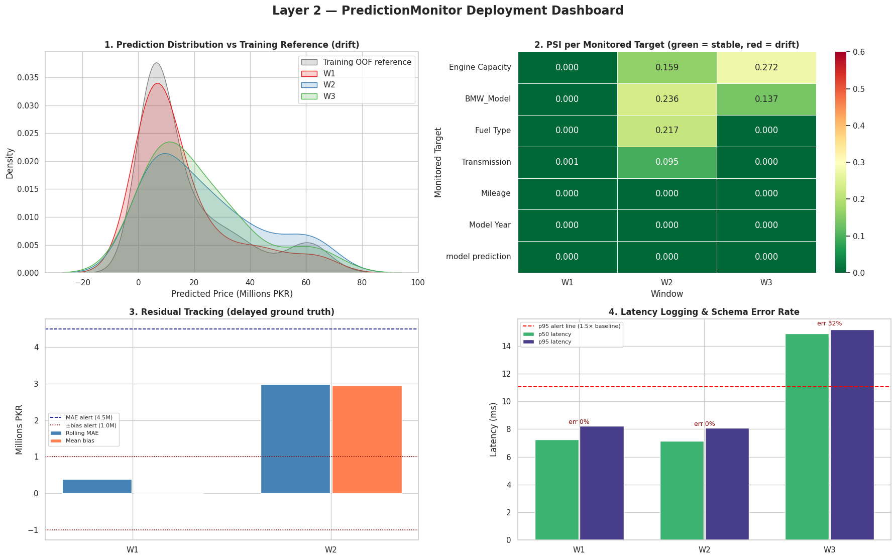
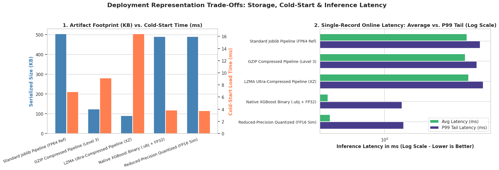

# Beyond R²: From a Skeptical Review to a Production System

**The complete arc of one BMW used-car pricing project: a code review that
challenged a "93.5% R²" claim → a leakage-free re-implementation that honestly
reports lower numbers → a four-layer production system with lineage, monitoring,
and a human-gated data flywheel. Three notebooks, three acts, one repo.**

Dataset: BMW used-car listings from a Pakistani marketplace — 344 raw rows → 228
clean rows, target = price in millions PKR (range 1.85–73M, heavily right-skewed).

## Act I — The Review: is the headline R² real?

The original community notebook on this dataset reported **93.5% R²** from a single
80/20 split. My review argued that on 344 rows a lone split is a lottery ticket,
that one-hot encoding fitted before the split leaks, and that near-duplicate
listings inflate scores. The review drew a detailed technical reply from Kaggle
community member **Alexandre Pedrosa** — a 15-item production checklist. The full
exchange is preserved verbatim in
[docs/community-review.md](docs/community-review.md).

The rest of this repo is what happens when you take that exchange seriously —
twice.

## Act II — The Rigorous Re-implementation ([notebook V4](notebooks/beyond-r-rigorous-bmw-price-pipeline.ipynb))

The first answer: implement the entire review checklist end-to-end, then honestly
report the lower numbers rigorous validation reveals.

| | Original notebook | This pipeline |
|---|---|---|
| Evaluation | Single 80/20 split | **GroupKFold (5 folds, 112 groups) + OOF predictions** |
| R² | 93.5% (one lucky split) | **OOF 0.8904** · fold mean 0.8135 ± 0.0969 (range 0.66–0.92) |
| MAE / RMSE | — | 3.91M / 6.13M PKR (OOF) |
| Seed stability | n/a | 0.9213 ± 0.0083 across seeds 42–46 |
| Inference | n/a | 257 KB model · 6.4 ms warm · 8,722 records/s |


The pipeline **flags its own weakness**: fold R² std = 0.097 > 0.05 triggers an
explicit `WARNING: high variance across folds`. Multi-seed std 0.0083 vs fold std
0.0969 — *model stable, data not*: the instability lives in the split, not in
training randomness.

Every engineering choice traces to a concrete review suggestion — the full
suggestion → implementation map (11 rows, with code references) lives in
[docs/community-review.md](docs/community-review.md); the condensed version:

| Suggestion | Implementation |
|---|---|
| Constraint-aware splitting for near-duplicates | `group_id` = name-prefix + year + fuel → GroupKFold |
| Fit all learned preprocessing per fold | OHE + scaler inside the fold-fitted Pipeline |
| Unified OOF evaluation report | Global + fold mean/std + residual analysis + per-fold timings |
| Version everything (hashes, seeds, schemas) | SHA-256 file + DataFrame hashes; `experiment_metadata.json` |
| Quantization: benchmark, don't assume | Concluded: 257 KB / 6.4 ms — not worth the complexity |

## Act III — The Production System ([notebook V5](notebooks/bmw-price-prediction-production-system.ipynb))

A pipeline is not a system. V5 keeps every V4 result and adds the four production
layers the community discussion proposed:

| Layer | Component | Verified behavior in this run |
|---|---|---|
| **1 — Lineage** | `LineageTracker` | SHA-256 + per-column hashes at 6 stages (`raw → cleaned → feature_engineered → holdout_split → cv_fold_assignment → market_refresh`); tamper detection at single-cell granularity (a `+1 km` edit to a stored copy fails verification); chain embedded in `deployment_manifest.json` v3 |
| **2 — Monitoring** | `PredictionMonitor` | Small-sample-hardened PSI (Jeffreys smoothing, rare-category pooling, (K−1)/n bias subtraction); separated data drift from concept drift; latency / schema-error / unseen-category alerts |
| **3 — Ingestion validation** | `DataIngestionValidator` | Schema / bounds / duplicates / near-dup entities + PSI drift vs golden reference |
| **4 — Collection agent** | `ListingCollectionAgent` | Pluggable source → normalizer → validator → **human review gate** → lineage-logged commit; semi-automatic by design |

**The split-scheme audit — the honest-number table of Act III** (same XGBoost,
different validation schemes):

| Validation scheme | R² |
|---|---:|
| Single 80/20 split | 0.9332 |
| Standard 5-fold CV (in-fold pipeline) | 0.9245 ± 0.0324 |
| **Constraint-aware 5-fold GroupKFold (near-dup entities never leak)** | **0.8624 ± 0.1598** |
| Repeated 5×5-fold (seed stability) | 0.9037 ± 0.0616 |

**Three simulated deployment weeks through the real inference engine:**

| Window | What happened | What the monitor caught |
|---|---|---|
| W1 (healthy) | 50 golden listings, cached singleton | PSI ≈ 0, MAE 0.38 M, p95 8.23 ms (1.12×) |
| W2 (drift + concept drift) | luxury/electric shift **and** +12% market uptick features can't see | PSI WARNs; **residual bias +2.96 M PKR → CRITICAL — concept drift separated from data drift** |
| W3 (incident) | malformed payloads + per-call reload anti-pattern | schema-error rate 32% (CRITICAL), p95 15.20 ms = **2.06× baseline**, unseen-category 8% |



**One agent cycle (21-row simulated weekly scrape, deliberately messy):**
comma prices, `'38,000 km'` mileage, an internal twin listing, schema violations,
an unseen `Hydrogen` prototype → Layer 3 drops 2 implausible rows and flags
PSI[Model Year] = 0.782 CRITICAL → 18 survive → review queue: 15 AUTO_ACCEPT,
2 relistings confirmed by a human, 1 Hydrogen prototype **rejected** ("insufficient
market evidence to pollute the golden set") → golden set 228 → 245, committed as a
new lineage stage.

Deployment benchmarks (inherited from V4's engine): per-call reload 12.91 ms →
cached singleton 7.09 ms (1.8×) → vectorized batch 0.038 ms (**340×**);
artifact formats from Joblib FP64 504 KB to LZMA 90 KB with identical predictions.



## Key takeaways (across all three acts)

1. **The 93.5% was a lucky split.** Act II: OOF 0.8904, fold mean 0.81 ± 0.10.
   Act III's audit: single-split 0.9332 vs near-dup-controlled 0.86 ± 0.16 —
   the gap between the two numbers is the size of the luck.
2. **The model is stable, the data is not.** Multi-seed std 0.0083 vs fold std
   0.0969 — more data would help more than any hyperparameter tuning (tuned MAE
   2.264 vs default 2.098, reported as-is).
3. **Drift is not one thing.** W2 separated data drift (PSI on features) from
   concept drift (residual bias) — two different alerts, two different remedies.
4. **Automation needs a gate.** The collection agent never auto-commits; the
   Hydrogen rejection shows why — one unverified prototype is not market evidence.
5. **Proportionality is an engineering decision too.** Act II benchmarks
   quantization and rejects it; Act III benchmarks five artifact formats and
   keeps the honest ones.

## Repository structure

```
├── notebooks/
│   ├── beyond-r-rigorous-bmw-price-pipeline.ipynb      # Act II — rigorous re-implementation (with outputs)
│   └── bmw-price-prediction-production-system.ipynb    # Act III — four-layer production system (with outputs)
├── src/bmw_pipeline.py                                  # Act II standalone script (compile-checked)
├── figures/                                             # Act II EDA/OOF plots + v5_* production-system plots
├── docs/community-review.md                            # Act I — the review exchange + reviewer identity
├── README.md · LICENSE (Apache-2.0) · requirements.txt
```

## Quick start

On Kaggle: attach the
[used-car-price-prediction dataset](https://www.kaggle.com/datasets/ahmedfakhar123/used-car-price-prediction-dataset)
and run either notebook top-to-bottom (CPU only; Act II fits a fold in ≈ 90 ms).

Locally (Act II only):

```bash
pip install -r requirements.txt
python src/bmw_pipeline.py --csv_path /path/to/BMW_Cars_Pakistan.csv --output_dir output
```

Act III's notebook expects the same Kaggle-attached dataset and the
`used-car-price-prediction-dataset` input path.

## License

[Apache-2.0](LICENSE)
