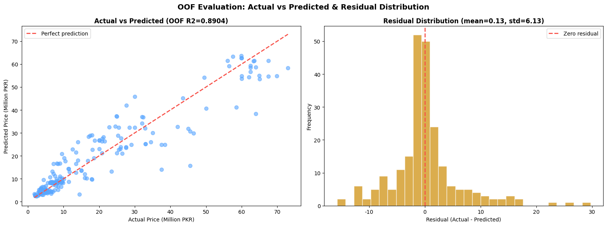

# Beyond R²: A Rigorous BMW Used-Car Price Pipeline

A production-grade tabular ML pipeline for BMW used-car prices (Pakistan marketplace
listings) built around one question: **is the headline R² real?**

It started as a code review. The original notebook on this dataset reported **93.5% R²**
from a single 80/20 split; my review argued that on 344 rows a lone split is a lottery
ticket, that one-hot encoding fitted before the split leaks, and that near-duplicate
listings inflate scores. The review drew a detailed technical reply from Kaggle community
member **Alexandre Pedrosa** — and this pipeline is the answer: it implements the entire
review checklist end-to-end, then honestly reports the lower numbers that rigorous
validation reveals. The full exchange is preserved in
[docs/community-review.md](docs/community-review.md).

## The honest results

| | Original notebook | This pipeline |
|---|---|---|
| Evaluation | Single 80/20 split | **GroupKFold (5 folds, 112 groups) + OOF predictions** |
| R² | 93.5% (one lucky split) | **OOF 0.8904** · fold mean 0.8135 ± 0.0969 (range 0.66–0.92) |
| MAE / RMSE | — | 3.91M / 6.13M PKR (OOF, meters of honesty) |
| Seed stability | n/a | 0.9213 ± 0.0083 across seeds 42–46 |
| Inference | n/a | 257 KB model · 6.4 ms warm · 8,722 records/s |



The pipeline **flags its own weakness**: fold R² std = 0.097 > 0.05 triggers an explicit
`WARNING: high variance across folds`. The diagnosis is written into the run log — the
instability lives in the data split (heterogeneous price segments; Fold 4 = 0.662 likely
holds rare models), **not** in training randomness (multi-seed std is 0.0083). That
separation — *model stable, data not* — is the whole point of the notebook.

## Architecture

**10 EDA steps** — quantified missingness → cleaning with before/after counts →
near-duplicate detection (same year+fuel+transmission+capacity, mileage within 5,000 km)
with price-difference distribution → target analysis + Shapiro–Wilk normality →
numerical outlier detection → Kruskal–Wallis tests for categoricals → mixed-unit engine
capacity → VIF multicollinearity → feature-engineering preview. Every step emits a
recorded "insight" that feeds the final EDA summary JSON.

**10 pipeline steps** — SHA-256 data versioning → cleaning + `group_id` construction →
feature engineering (BMW model extracted from listing name; **OHE deferred into the
Pipeline to kill leakage**) → unified `sklearn.Pipeline`:
`ColumnTransformer(StandardScaler, OneHotEncoder(handle_unknown="ignore")) → XGBRegressor`
→ GroupKFold(5) + OOF → extended evaluation report (fold mean/std, residual stats,
residual-vs-feature correlations, per-fold timings) → final model + full metadata JSON →
inference class → multi-seed reproducibility → inference benchmark.

**Parallelism budget** — `xgb_threads=2 × fold_jobs=4 ≤ physical cores`, recorded in
metadata, to avoid the oversubscription trap (fold-level and XGBoost-internal threading
competing for cores).

## Review → implementation map

The centerpiece of this repo: every engineering choice traces back to a concrete
suggestion in the community exchange. Condensed version — full mapping with code
references in [docs/community-review.md](docs/community-review.md):

| Suggestion | Implementation |
|---|---|
| 5-fold / repeated CV | GroupKFold(5) + OOF; RepeatedKFold(5×3) fallback |
| Fit all learned preprocessing per fold | OHE + scaler inside the fold-fitted Pipeline |
| Constraint-aware splitting for near-duplicates | `group_id` = name-prefix + year + fuel → GroupKFold |
| Unified OOF evaluation report | Global + fold mean/std + residual analysis + per-fold timings |
| Cap XGB threads when parallelizing folds | `xgb_threads=2 × fold_jobs=4`, benchmarked and recorded |
| Record durations, latency, artifact size | Per-fold fit/score times; model size; cold/warm/batch latency |
| Version everything (hashes, seeds, schemas) | SHA-256 file + DataFrame hashes; `experiment_metadata.json` |
| Load model once; batch inference | `BMWPricePredictor` with load-once `__init__` |
| Validate inference inputs against schema | Range checks + categorical whitelists; `handle_unknown="ignore"` |
| Quantization: benchmark, don't assume | Concluded: 257 KB / 6.4 ms — not worth the complexity |
| Report fold dispersion explicitly | Auto-warning when R² std > 0.05 |

## Repository structure

```
├── notebooks/beyond-r-rigorous-bmw-price-pipeline.ipynb   # original Kaggle notebook (with outputs)
├── src/bmw_pipeline.py                                    # standalone script (cell-order assembly, compile-checked)
├── figures/                                               # all plots extracted from the demo run
├── docs/community-review.md                               # the Kaggle review exchange + reviewer identity
├── README.md · LICENSE (Apache-2.0) · requirements.txt
```

## Quick start

On Kaggle: attach the
[used-car-price-prediction dataset](https://www.kaggle.com/datasets/ahmedfakhar123/used-car-price-prediction-dataset)
and run all cells of the
[notebook](https://www.kaggle.com/code/zhenruiweng/beyond-r-rigorous-bmw-price-pipeline).

Locally:

```bash
pip install -r requirements.txt
python src/bmw_pipeline.py --csv_path /path/to/BMW_Cars_Pakistan.csv --output_dir output
```

## Dataset

BMW used-car listings from a Pakistani marketplace: **344 raw rows → 228** after
dropping missing prices and 69 exact duplicates, organized into 112 groups. Six features
(Model Year, Mileage, Engine Capacity, Fuel Type, Transmission, BMW_Model extracted from
the listing name); target = price in millions PKR (range 1.85–73M, heavily right-skewed,
skew 1.50).

## Key takeaways (the notebook's own reflection)

1. **The 93.5% was a lucky split.** OOF R² = 89.0%, fold mean = 81.4%. Cross-validation
   is what Alexandre insisted on, and the gap between the two numbers is the size of the luck.
2. **The model is stable, the data is not.** Multi-seed std 0.0083 vs fold std 0.0969 —
   more data would help more than any hyperparameter tuning.
3. **Luxury outliers are the weakness.** Residual max +29.7M PKR: rare 7 Series / i8
   listings are severely under-predicted. GroupKFold can't fix that — only more luxury
   data can.
4. **Engineering choices validated, over-engineering avoided.** 257 KB, ms-level
   latency, no residual-feature correlation, no bias — and no quantization, no Docker,
   no CI/CD for 228 rows. Proportionality is an engineering decision too.

## License

[Apache-2.0](LICENSE)
